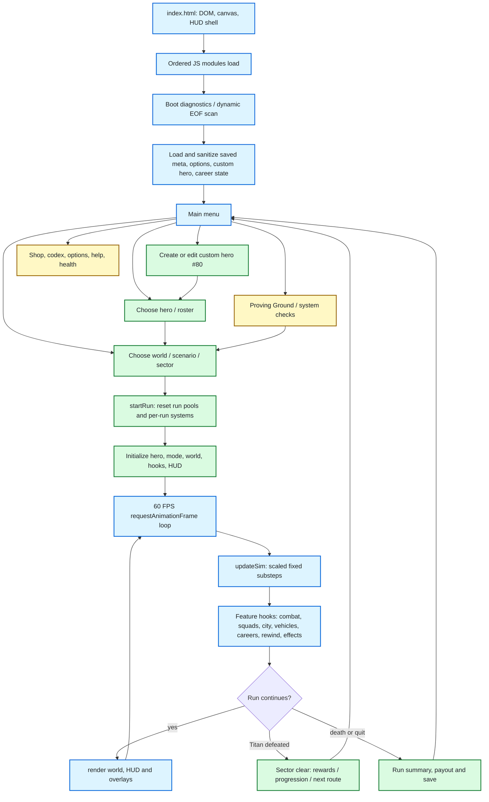
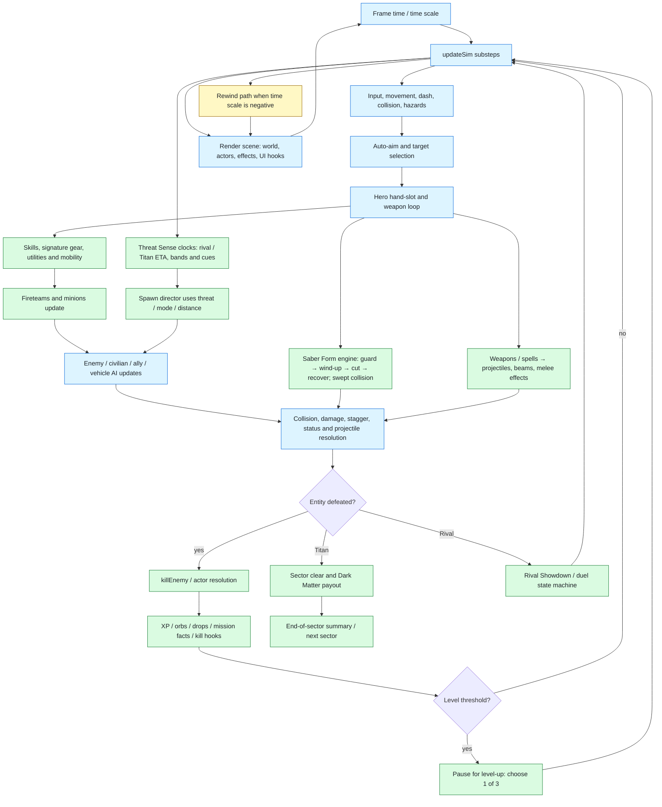
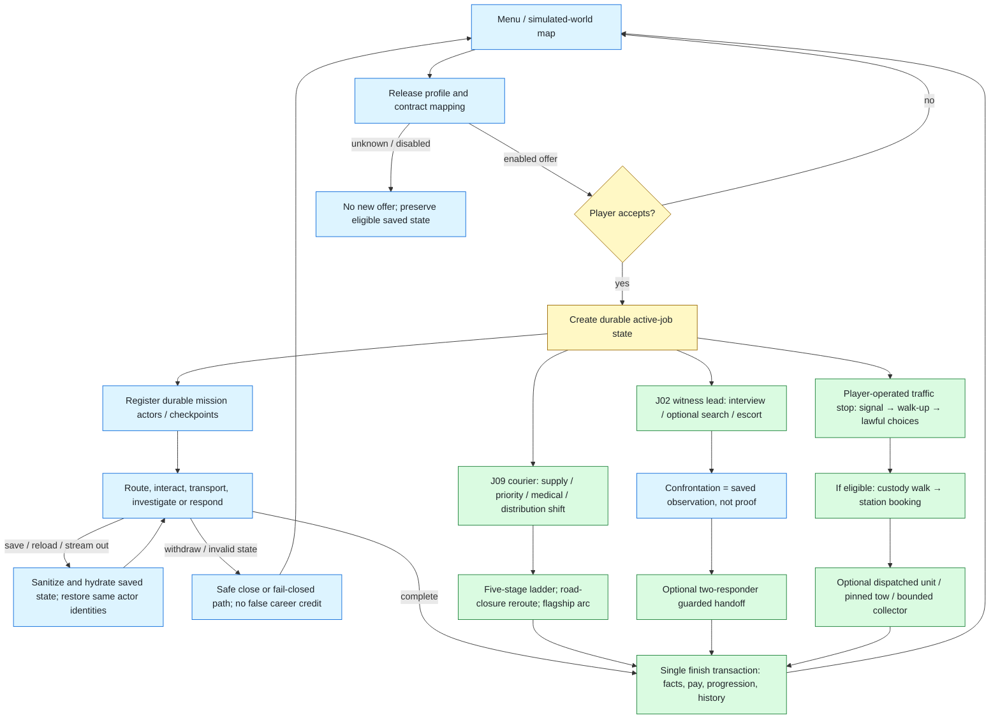
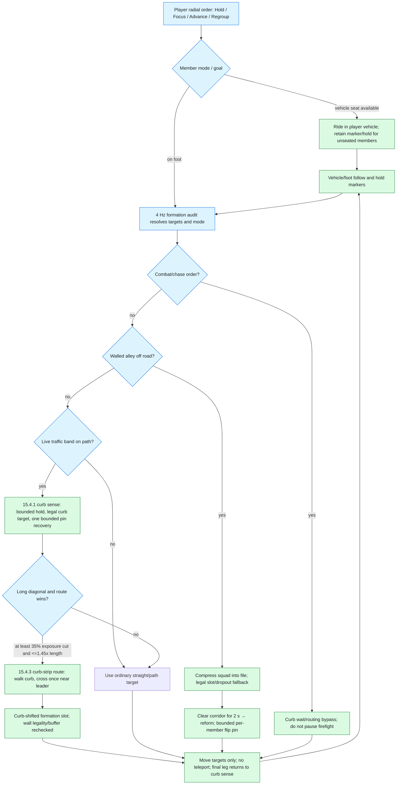
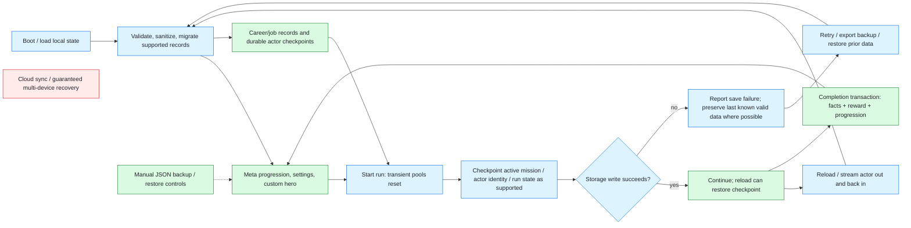
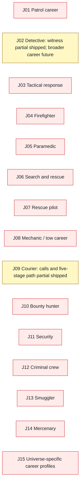

# Omni-Shift: Nexus Survivors

> **Project flow map — current through `15.4.4-DEFERRED-LOCK`**  
> Runtime/gameplay code is the `15.4.3-LOCKED` build. `15.4.4` is a documented stopping point, not a new gameplay release.  
> **v15 overall: 71% · T21: 50% · next planned series: 15.5.1 (not started).**

This is the GitHub-ready project overview and Mermaid flowchart. GitHub renders the diagrams below directly. Update this file when a feature ships, changes state, or is deferred.

## Status key

| Color | Meaning |
|---|---|
| 🟩 Green | Implemented and shipped at a locked milestone. |
| 🟨 Amber | Partial / bounded / shipped with explicit limits. |
| 🟥 Red | Future, incomplete, or not yet verified. |
| 🟪 Purple | Shelved / parked; preserve for a later restart. |
| 🟦 Blue | Shared runtime or infrastructure flow. |

The diagrams also use Mermaid classes for color. The prose/table legend is retained for viewers that do not render inline styles.

---

## 1. Whole-game flow

## 2. Simulation and combat pipeline

### Combat and encounter details

- **Rival Showdown:** rival arrival → challenge/entrance → duel → rival defeat or bounded timeout → normal combat resumes. Crowd spectators are excluded from ordinary targeting; a Titan or later rival waits while the duel is active.
- **Threat Sense:** clocks advance with distance-based threat scaling; cues rise through bands; rival/Titan spawn uses the engine's spawn path. Showdown suspends the ordinary clocks.
- **Force allies:** eligible hostiles can be persuaded/lifted → temporary ally → hunt, escort, expire, or die. Specials exclude protected encounter types; ally lifetime and rewards are bounded.
- **EXECUTE:** staggered eligible target → ready state → finisher → optional queued chain. It does not execute an unstaggered target.
- **Rewind:** recorded run state is interpolated backward within the keyframe window. Echo kills do not pay out; persistent/meta progress follows its own save rules.

---

## 3. World, map, stealth and traffic flow

```mermaid
flowchart LR
  classDef system fill:#ddf4ff,stroke:#0969da,color:#1f2328;
  classDef shipped fill:#dafbe1,stroke:#1a7f37,color:#1f2328;
  classDef partial fill:#fff8c5,stroke:#9a6700,color:#1f2328;
  classDef future fill:#ffebe9,stroke:#cf222e,color:#1f2328;

  CHOOSE["Select world / mode / seed"] --> MODE{"World source"}
  MODE -->|Nexus / classic| CITY["Procedural city or classic arena generator"]
  MODE -->|Homeworld / region| REGION["Region profiles → macro cells → blocks → sites"]
  MODE -->|Real map| REAL["Real-map adapter: local packs or online map source"]
  REAL -->|available| REALGEN["Roads, water, parks, POIs and footprints"]
  REAL -->|unavailable| FALLBACK["Generated fallback and status banner"]
  CITY --> CELL["Cells, roads, lots, buildings, props and spawn records"]
  REGION --> CELL
  REALGEN --> CELL
  FALLBACK --> CELL
  CELL --> INT["Interiors, doors, windows and furniture"]
  CELL --> CHUNK["Streaming chunks and world queries"]
  INT --> CHUNK
  CHUNK --> COLL["Collision, path/ray checks, LOS, roof/fence/access"]
  COLL --> SENSE["Per-hero perception, sound, stealth and awareness"]
  CELL --> TRAFFIC["Traffic lanes, junction controls and live vehicles"]
  TRAFFIC --> VEH["Player vehicle, patrol traffic and dispatch-unit routes"]
  CHUNK --> BAKE["Theme and baked world rendering"]
  BAKE --> FRAME["Frame: static tiles + live actors, doors, traffic, effects"]
  SENSE --> FRAME
  VEH --> FRAME
  FRAME --> PLAY["Combat, missions, exploration and HUD"]

  class CHOOSE,MODE,CITY,REGION,REAL,REALGEN,CELL,INT,CHUNK,COLL,BAKE,FRAME,PLAY system;
  class TRAFFIC,VEH,SENSE shipped;
  class FALLBACK partial;
```

> **Asset boundary:** this source/history package intentionally excludes map payloads and music/audio files. The project code supports generated worlds and asset-backed/online paths, but an offline real-map or full soundtrack experience requires those assets separately.

---

## 4. Mission, career and dispatch flow

**Shipped partial careers are not claims that their parent careers are complete.** J02 witness work and J09 courier calls are active partials; the full J01 patrol career is not complete, despite player-operated patrol/traffic-stop features shipped under T18. Actor durability shipped in 15.3.1; player patrol workflow in 15.3.2; driven dispatch arrival and unit tow flow in 15.3.3.

---

## 5. Fireteam, vehicle and squad-navigation flow (T21)

**T21 ledger:** curb sense locked at 15.4.1; alley file-compressed formations locked at 15.4.2; sidewalk-sense long-march routing locked at 15.4.3. T21 is 50% overall: faction-specific pace/interval, cover routing, doors and mount/dismount safety remain future work.

---

## 6. Persistence, save and recovery flow

Persistence is browser-local and fail-closed in tested paths; this diagram does **not** claim cloud backup, guaranteed recovery from device/browser loss, or physical-device coverage.

---

## 7. Roadmap and deferred scope

### Career reservations J01–J15

### Shared systems T16–T31

```mermaid
flowchart TD
  classDef partial fill:#fff8c5,stroke:#9a6700,color:#1f2328;
  classDef future fill:#ffebe9,stroke:#cf222e,color:#1f2328;
  classDef parked fill:#fbefff,stroke:#8250df,color:#1f2328;
  classDef shipped fill:#dafbe1,stroke:#1a7f37,color:#1f2328;

  T16["T16 Job selection / dispatch / save-safe incidents: shared pieces shipped; full scope open"]:::partial
  T17["T17 Career progression / living-world consequences: partial"]:::partial
  T18["T18 Police / logistics: patrol stop, actor call unit and unit tow shipped; pursuit / multi-unit work future"]:::partial
  T19["T19 Actor identity: durable in-session records shipped; long-term memory future"]:::partial
  T20["T20 Shot awareness / civilian safety: partial shared systems"]:::partial
  T21["T21 Squad navigation: 15.4.1–15.4.3 shipped; 50%; remaining tactics future"]:::partial
  T22["T22 Convoy safety/recovery: partial; overflow/parking/recovery limits remain"]:::partial
  T23["T23 Material-aware destruction and repair"]:::future
  T24["T24 Generated-world scale and migration"]:::future
  T25["T25 Flight and character-specific abilities: existing flight; broader scope partial"]:::partial
  T26["T26 Touch driving, cruise and tire behavior: partial"]:::partial
  T27["T27 Saves, backup and older-feature compatibility: partial"]:::partial
  T28["T28 Accessibility and browser/device coverage: partial"]:::partial
  T29["T29 Performance and intermittent vehicle travel: partial"]:::partial
  T30["T30 Full regression / acceptance gates: open"]:::future
  T31["T31 Assets, merged-site verification and final v15 release: open"]:::future
  NOW["Current stop: 15.4.4-DEFERRED-LOCK; v15=71%, T21=50%"]:::parked
  NEXT["15.4.4 hardening and 15.4.5 integration are shelved; 15.5.1 not started"]:::parked
  NOW --> NEXT
```

### Current ratchet stop

```mermaid
flowchart LR
  classDef shipped fill:#dafbe1,stroke:#1a7f37,color:#1f2328;
  classDef parked fill:#fbefff,stroke:#8250df,color:#1f2328;
  classDef future fill:#ffebe9,stroke:#cf222e,color:#1f2328;

  A["15.4.1-LOCKED: curb sense"]:::shipped --> B["15.4.2-LOCKED: alley file formation"]:::shipped
  B --> C["15.4.3-LOCKED: sidewalk-sense march routes"]:::shipped
  C --> D["15.4.4-DEFERRED-LOCK: hardening shelved"]:::parked
  D --> E["15.4.5 integration ceremony: shelved; v15 stays 71%"]:::parked
  E -. "resume only with explicit approval" .-> F["15.5.1 next series; not started"]:::future
```

## Current lock facts

- **HEAD/tag:** `15.4.4-DEFERRED-LOCK` (`aba6f94`). This README is a new uncommitted documentation file, ready to add at the repository root.
- **Runtime:** gameplay source remains `15.4.3-LOCKED`; the 15.4.4 stop commit is documentation/ledger state, not a new gameplay feature release.
- **Metrics:** v15 overall **71%**; T21 **50%**. Do not raise the v15 figure until the deferred 15.4.5 integration lock is explicitly resumed and completed.
- **Recent shipped QA:** 15.4.3 sidewalk-march fixture 6/6 ×2; 15.4.2 formation fixture 7/7; 15.4.1 curb fixture 6/6; pack 240/240; gauntlet 19/19. These are historical lock results, not a new test run caused by this README.
- **Shelved queue:** rerun run1541/42/43, pack and gauntlet on resume; consolidate SQSIDE counters into a smoke assertion; then the 15.4.5 integration ceremony.
- **Release constraints:** no new mechanics in 15.4 without renewed approval; do not mark deferred items green or equate an estimate with test coverage.

## Source-of-truth files

- `js/` — runtime modules; `index.html` — ordered script entry point.
- `CHANGELOG_v15.md` — lock-by-lock implementation and QA history.
- `RELEASE_SCOPE_v15.md` — shipped behavior and boundaries.
- `DEFERRED_FEATURES_v15.md` — J/T backlog and current deferrals.
- `CHRONO_LATTICE_RATCHET_LEDGER_v15.md` — ratchet operating/decision ledger.
- `qa/NEXT_STATE.md` — exact shelved resume queue and current stop.
- `flowchart.md` and `info.md` are older v14.2 design references; this README is the current high-level flow map. Update it together with the ledgers when state changes.
