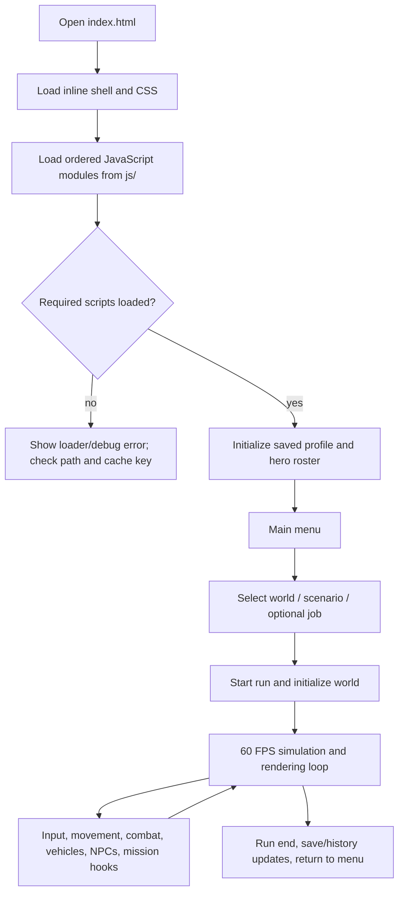
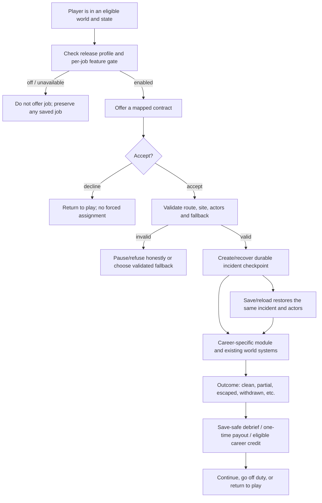
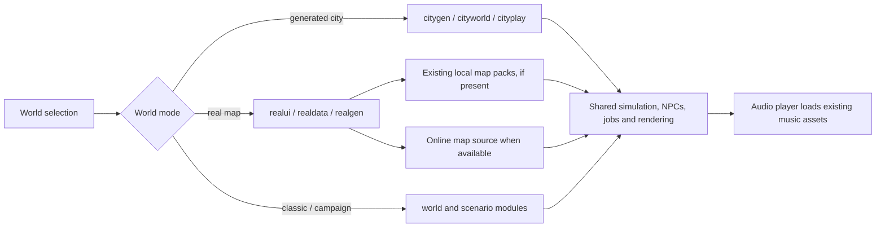

# Current project flowchart — 15.6.6

These diagrams describe the current static game architecture at `15.6.6-LOCKED`. The map and music data payloads are intentionally external to this snapshot; their loaders/runtime code remain in `js/`.

## Browser boot and play loop

## Optional job / incident lifecycle

Current career modules include patrol, detective, firefighter, tactical response, EMT, courier, and shared dispatch/routing systems. In 15.6.6, scene/POI detective features are enabled while parent J02 remains off; J05 EMT is enabled.

## World and content paths

