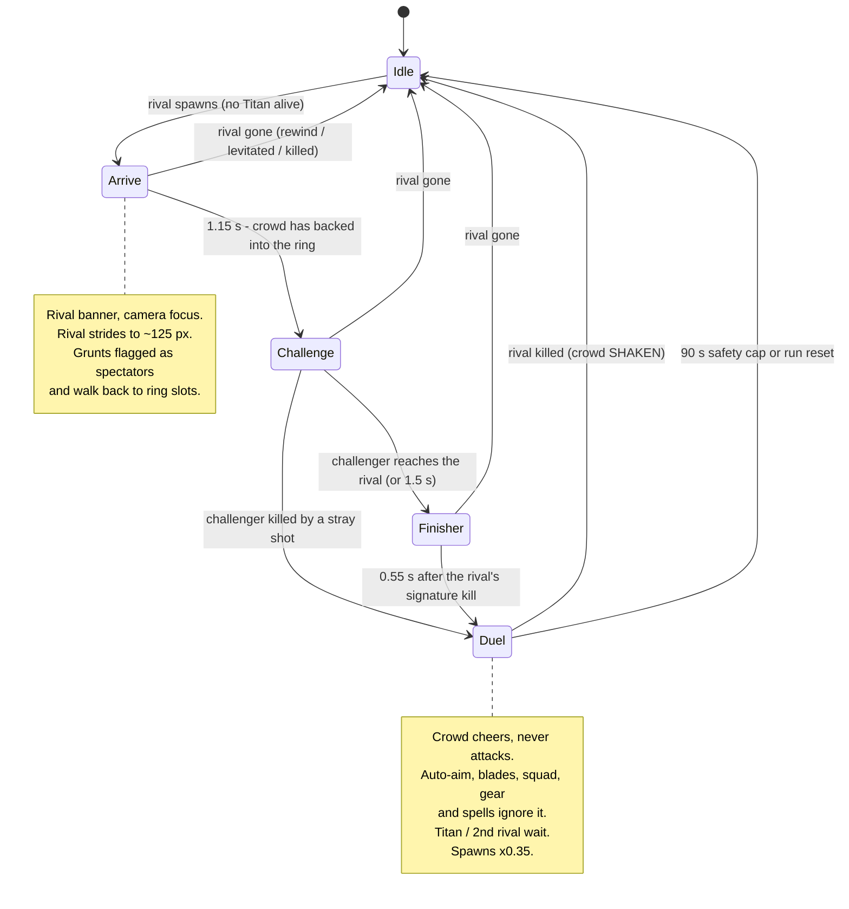
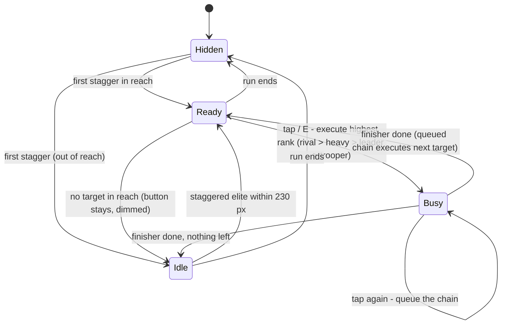
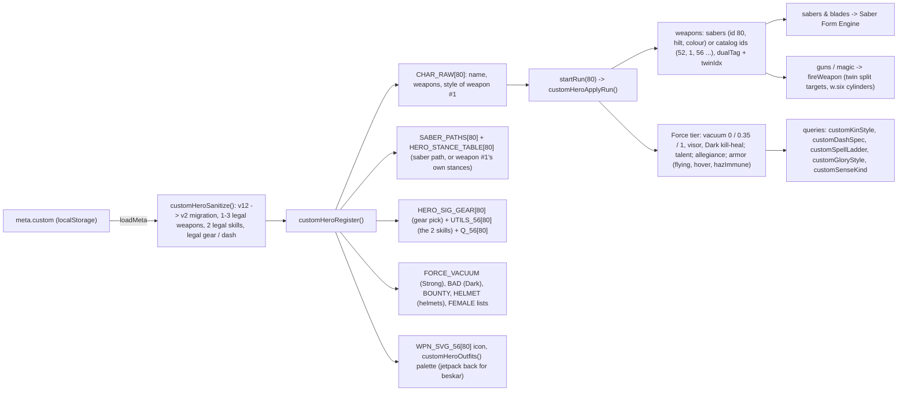
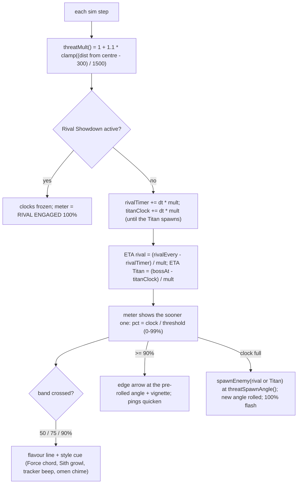
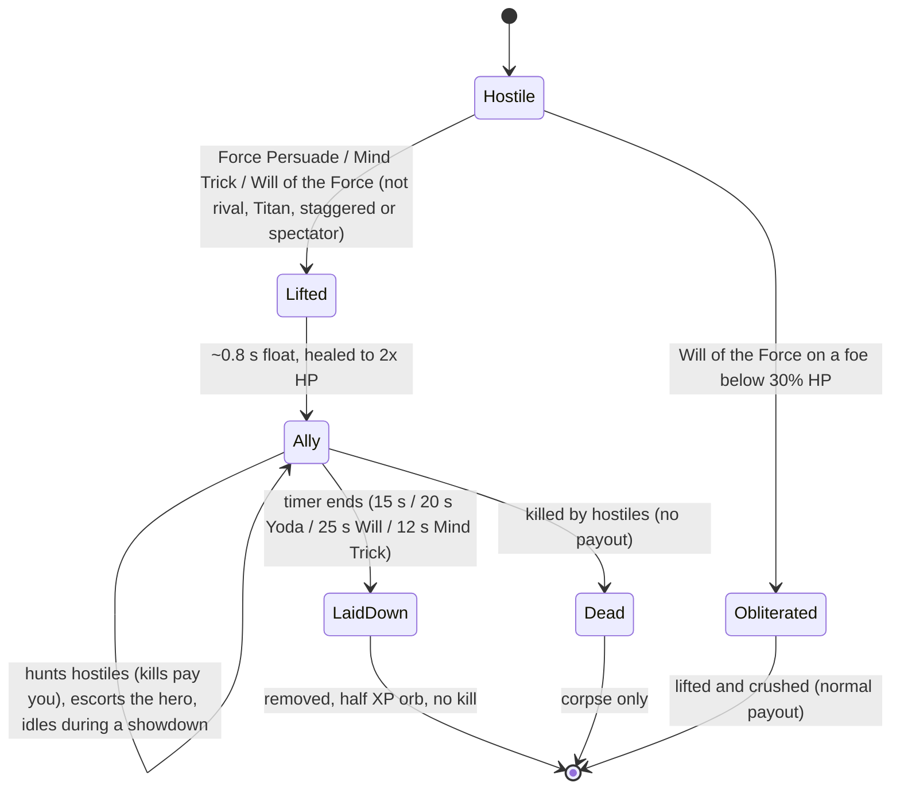
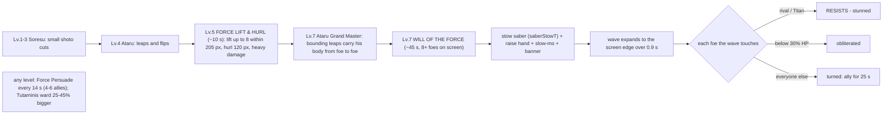

# FILE: flowchart.md
# PART: 2 of 14
# DETAIL: Current State Architecture & Execution Flowcharts (v13, 2026-10-28) — boot, menus, Hero Creator v2, run start, the 60 FPS loop, simulation (Threat Sense clocks, Force-persuaded allies, Yoda's powers), Saber Form Engine, Rival Showdown, glory kills / EXECUTE, rendering and end of run. Feature descriptions live in info.md.

## 1. Whole-game flow

```mermaid
flowchart TD
  %% === 1. BOOT (index.html + js/ui.js + js/state.js) ===
  subgraph BOOT["1. BOOT & DOM SHELL"]
    A["index.html: safe removeChild wrapper, live debugger, music player shell"] --> B["Ordered script loader: 23 files, cache-bust ?v=v13-2026-10-28"]
    B --> B2["chaos, data-factions, data-heroes, data-relics, state, world, combat, sim, render"]
    B2 --> B3["fx, rewind, arsenal, squad, glory, showdown (v12), sense (v13), force (v13), biomes, campaign, proving, saberforms (v11), creator (v13 v2), ui"]
    B3 --> C["checkLoadedScripts() + runDynamicEOFScan()"]
    C --> E["loadMeta(): localStorage OMNISHIFT_META_V1"]
    E --> E2["customHeroSanitize(meta.custom): v12 saves migrate to v2, then customHeroRegister() writes CHAR_RAW[80] + kit tables"]
    E2 --> F["updateMenuUI() -> Main Menu (#scrMain)"]
  end

  %% === 2. MENUS ===
  subgraph MENUS["2. MENU SCREENS"]
    F -->|DEPLOY INTO NEXUS| G["startRun() (js/combat.js)"]
    F -->|Character Roster| H["renderChars(): top card = Your Hero #80, then 80 heroes in 11 genres"]
    F -->|CREATE YOUR OWN HERO| CR["openCreator() -> #scrCreate (js/creator.js)"]
    H -->|EDIT / create card| CR
    H -->|hold 350ms| L["openInspector() + outfit customizer"]
    F -->|Galactic Expedition| CAMP["renderCampaign(): branching sector map, modifiers, warlords"]
    CAMP --> G
    F -->|Classic list| I["renderStages(): 50 sectors"]
    F -->|Shop| J["renderMeta(): Dark Matter upgrades + 100% respec"]
    F -->|Proving Ground| PG["startProvingGround(): 14 live actions, PASS / FAIL panel"]
    PG --> G
    F -->|Options / Codex / Health / Help| MISC["opts, codex, telemetry, HUD guide (NEW IN v13 box)"]
  end

  %% === 3. HERO CREATOR v2 (v13) ===
  subgraph CREATE["3. HERO CREATOR v2 #80 (js/creator.js)"]
    CR --> CR0["Presets: Jedi Knight, Sith Lord, Twin-Gun Drifter, Force-Touched Wizard, Space Cowboy, Smuggler, Mandalorian, Jar'Kai"]
    CR0 --> CR1["Identity: name, allegiance (Light / Dark / Grey / Bounty), Force (None / Touched / Strong), talent"]
    CR1 --> CR2["Weapons 1-3 from 26 (saber, staff, blades, pistols, rifles, heavy, magic, tech); twins = separate weapons"]
    CR2 --> CR3["Per lightsaber: hilt (10) + colour (10) + Form path"]
    CR3 --> CR4["Exactly 2 skills, 1 gear, 1 mobility, 1 armor - crReqOk() locks what the build can't use"]
    CR4 --> CR5["Look: species, body, skin, hair, headgear, outfit, legs, cloak; live preview (flight shown for beskar)"]
    CR5 -->|SAVE| CR6["meta.custom (v: 2) saved, selChar = 80, customHeroRegister()"]
    CR6 --> F
  end

  %% === 4. RUN START ===
  subgraph INIT["4. RUN INITIALIZATION (js/combat.js startRun)"]
    G --> N["purgeRunMemory(): clear every SoA pool"]
    N --> O["player object: stats, limbs[6], visor, dash spec, armCap, starting weapon + bladeCol"]
    O --> O2["hero stat block (#00-#79)"]
    O2 --> O3["hero #80 -> customHeroApplyRun(): 1-3 weapons (twinIdx, own cylinders), Force tier, talent, allegiance, armor (beskar: flying)"]
    O3 --> Q["syncHeroSpellbook()"]
    Q --> HK["V10.onRunStart hooks: campaign modifiers, adaptive biome, squads, rewind buffer, fx, glory reset, showdown reset, saber reset"]
    HK --> HK2["v13 hooks: senseReset (pre-rolled rival / Titan angles), forceReset (allies, Yoda timers), crKit reset"]
    HK2 --> R["#hud active -> requestAnimationFrame(loop)"]
  end

  %% === 5. FRAME LOOP ===
  subgraph LOOP["5. 60 FPS FRAME LOOP (js/ui.js loop + js/sim.js)"]
    R --> LP["loop(ts): rawDt"]
    LP -->|timeScale >= 0.1| US["updateSim(rawDt * timeScale * fxTimeMul) in sub-steps"]
    LP -->|timeScale < 0| RW["rewindPlayback(): keyframe ring buffer, interpolation, echoes"]
    US --> RS["renderScene()"]
    RW --> RS
    RS --> HUD["updateHUD(): in-place DOM (weapons, skills, dash, limbs, spellbar)"]
    HUD --> OF["V10.onFrame hooks: EXECUTE button state, Threat Sense HUD meter, fx banners, proving panel, music UI"]
    OF --> LP
  end

  %% === 6. SIMULATION STEP ===
  subgraph SIM["6. updateSim() - ONE STEP"]
    US --> S1["Input + movement + obstacles + biome hazards (player.flying skips obstacles)"]
    S1 --> S2["Auto-aim: nearest on-screen enemy, skips staggered elites, the showdown crowd and allies"]
    S2 --> S3["Hand-slot loop (armCap)"]
    S3 -->|lightsaber / sword| SF["saberEngineStep(): guard -> wind-up -> strike -> recover, swept collision, deflect + redirect"]
    S3 -->|gun / staff / wand| FW["fireWeapon() -> spawnProj() / castArcaneSpell(); odd twins take the 2nd-nearest target; six-shooters use w.six"]
    S3 --> SP["updateHeroSpecials(): utilities, signature gear, dash, CQC"]
    SP --> MN["squadMinionsSim(): fireteams + minions (skip the crowd)"]
    MN --> SPN["Spawn director: wave population; titanClock + rivalTimer tick x threatMult() (1.0-2.1 by distance), frozen during a showdown; spawns x0.35"]
    SPN -->|rival / Titan due| RIV["spawnEnemy() at threatSpawnAngle() -> showdownBegin() for rivals"]
    SPN --> EN["Enemy AI loop (MAX_E = 360)"]
    EN --> EA["v13: allyIs(i)? -> allyEnemyStep(): hunt hostiles, friendly bolts, escort, lay down arms on expiry"]
    EA --> EN1["levitate / bleed / stagger / stun / grapple"]
    EN1 --> EN2["v12 showdownEnemyStep(): spectators hold the ring, rival entrance, challenger charge"]
    EN2 --> EN3["formations + ChaosMath steering (brawl with an ally within 62 px) + firing + contact damage"]
    EN3 --> PRJ["Projectile loop (MAX_P = 520): hits, deflection, ricochet, homing"]
    PRJ --> ORB["XP orbs -> triggerLevelUp() (#scrLevel, twin sabers get separate cards)"]
    ORB --> STEP["V10.onStep hooks: glory, showdown, Threat Sense (bands, cues), Force (persuade, Yoda lift / Will), creator kit (detonators, chokes), rewind, fx, squads, campaign, proving"]
  end

  %% === 7. KILL PIPELINE ===
  subgraph KILL["7. killEnemy()"]
    SF --> K["killEnemy(idx, headshot, sliceAngle, glow)"]
    FW --> K
    EN3 --> K
    K --> K1["V10.onKill: rewind echo list, kill-streak fx, campaign counters"]
    K1 --> K2["corpse / bisected halves / limbs + XP orb (none for echoes or no-pay kills)"]
    K2 -->|Rival 98 or Titan 99| K3["weapon drop + relic + trophy corpse; rival death ends the showdown"]
    K3 -->|Titan| K4["onSectorTitanDefeated(): sector cleared, Dark Matter banked"]
  end

  %% === 8. RENDER ===
  subgraph RENDER["8. renderScene() (js/render.js)"]
    RS --> R1["fx camera: shake, zoom, focus, letterbox"]
    R1 --> R2["biome ground, props, hazards, world objects"]
    R2 --> R3["gore pools: drips, limbs, corpses, bisected halves"]
    R3 --> R4["enemies: grunts (spectators pump fists), allies (halo, ground ring, green bar), lifted foes, rivals as hero sprites"]
    R4 --> R5["drawHeroSprite(player): outfit, #80 species / armor / headgear / helmet, jetpack flight (lift + shadow + jets), Form-posed blades"]
    R5 --> R6["particles + projectiles + damage text"]
    R6 --> R7["V10.onRenderWorld: EXECUTE reticle, showdown ring, Threat pings, persuasion beams, Will of the Force wave, grenades"]
    R7 --> R8["V10.onRenderScreen: rewind VHS overlay, banners, Threat edge arrow + vignette, letterbox, perf pill"]
  end

  %% === 9. END OF RUN ===
  subgraph END["9. END OF RUN"]
    STEP -->|HP 0, no revives| X1["resolvePlayerDeath() -> endRun('death')"]
    PAUSE["Pause -> END RUN"] --> X2["endRun('quit')"]
    X1 --> X3["Dark Matter payout + summary screen (#scrSummary)"]
    X2 --> X3
    X3 -->|Deploy again / next sector / menu| F
  end
```

## 2. Rival Showdown state machine (js/showdown.js)

## 3. EXECUTE button states (js/glory.js, v12)

## 4. Custom hero data flow (#80, Creator v2)

## 5. Threat Sense (js/sense.js, v13)

## 6. Force Persuasion ally lifecycle (js/force.js, v13)

## 7. Yoda's Grand Master powers (by saber level)

